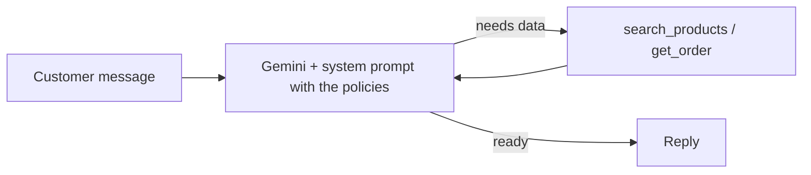

# Empório da Música: Customer Service Agent

A text-message agent for Empório da Música, a fictional musical instrument store in Campo Grande/MS. "Tom", the assistant, answers in Brazilian Portuguese about products, prices, stock, promotions, orders and store policies, and politely declines anything out of scope.

## How to run

Requires Python 3.13 (the version tested) and a Google Gemini API key, which you can create for free at [Google AI Studio](https://aistudio.google.com/apikey).

```bash
python -m venv .venv
.venv\Scripts\activate            # Windows
# source .venv/bin/activate       # Linux/macOS
pip install -r requirements.txt
```

Copy `.env.example` to `.env` and add your key, then:

```bash
python agent.py          # chat in the terminal; type "sair" to quit
python test_tools.py     # checks price and privacy rules (no API key needed)
python run_examples.py   # regenerates missing files in examples/
```

To use another model, set `GEMINI_MODEL` in `.env`.

To try an order lookup, use order `7` with phone `(67) 99789-0123`.

## How it works



| File | Purpose |
|---|---|
| `agent.py` | Persona, prompt, LangGraph graph and terminal chat |
| `tools.py` | Catalog search and order lookup over the CSVs |
| `data/policies.md` | Store manual, cleaned from the PDF |
| `test_tools.py` | Checks for the rules that must not depend on the LLM |
| `examples/` | Real conversations generated by `run_examples.py` |

## Technical decisions

**Approach: function calling for data, policies in the prompt.** Data changes and must be exact, so the model has to fetch it through a tool. Policies are short and fixed, so they are always in context, and the model doesn't need to decide whether to look them up.

**No RAG.** The manual has 8 pages and about 1,700 words, which fits easily in the prompt. Retrieval would add chunking, embeddings and the risk of missing the right passage, with no benefit at this size. I would add it if the manual grew to the point of hurting cost or answer quality.

**No SQL agent.** There are few tables and the questions are predictable. Two fixed tools are safer than generated SQL, since the model can't reach customer data except through the identity check.

**LangGraph, kept small.** The graph has two nodes in a loop: model and tools. It gives me the tool loop and per-conversation memory in a few lines, and leaves room for more steps, such as a handoff to a human. I wrote the graph explicitly instead of using a prebuilt agent so the flow is visible.

**Gemini.** Free tier, native function calling, and I already use it in production at work. I chose `gemini-3-flash-preview` because other models were overloaded or over quota when I tested them; since it is a preview, the model can be changed through `GEMINI_MODEL`. Temperature is 0 because support answers should be consistent, not creative.

**Business rules live in code, not only in the prompt.** An LLM can be talked out of an instruction, so the rules that matter most are enforced in Python:
- Promotional and PIX prices are computed in `tools.py`, so the model doesn't do the math.
- Expired promotions are dropped when the data is loaded, so they can't be offered.
- `get_order` returns nothing without the matching phone or email, and gives the same answer for a wrong contact and a missing order, so nobody can probe for valid orders (LGPD).

**Prompt strategy.** The persona follows the tone in section 7 of the manual. The prompt then says which source to use for each kind of question, followed by explicit rules: never invent, list only available items, and never claim to perform actions the agent can't do.

**Interface and history.** A terminal chat, because the challenge's focus is the agent. History is kept in memory during the session (`MemorySaver`): follow-up questions need it, but persisting between sessions adds nothing to a prototype.

**Data treatment.**
- The PDF was transcribed to Markdown because automatic extraction scrambled its tables, including opening hours, which could have led to wrong answers.
- The CSVs were checked for broken references and invalid prices, and none were found, so they are used as provided.
- Search ignores accents, so "violao" finds "violão".

## Assumptions

- **Today is 2026-03-25.** The data ends in March 2026, so the date is fixed just after the last order. Otherwise every order would look months old and every return would be refused.
- **Receipt date is unknown.** The data only has the estimated delivery date, so the agent uses it as a reference and asks the customer to confirm when the product arrived.
- **Conflicts in the manual:**
  - It gives two phone numbers: (67) 3341-4444 and (67) 3321-4500. I used the first, which appears on the cover and in the company details.
  - It gives two email spellings. I used the one without an accent, since accented addresses are uncommon.
  - It gives a general R$ 100 minimum installment and a more detailed set of rules by number of installments. I used the detailed rules.
  - It says the catalog has over 300 instruments, while the CSV has 65. The agent answers only from the CSV.
- **Partner stores.** The manual suggests recommending them for accessories but lists none, so the agent recommends a specialist store without naming one.

## Known limitations and what I would do with more time

- The agent only reads data. It can't cancel, refund or record complaints, so it directs the customer to the team. Next step: a real human handoff that passes along the conversation context.
- History is lost when the program closes. A database-backed checkpointer would fix this.
- Search is by keyword, so it doesn't understand "something for a beginner" unless those words are in the description. Semantic search over the catalog would help.
- The free Gemini tier allows few requests per minute (5 on this model) and can return overload (503) and quota (429) errors. The agent retries and then shows an error. A paid tier or a fallback model would make this more reliable.
- I have no automated tests of the agent's answers, only of its tools. I would add an evaluation set of questions with expected behavior, to catch regressions when the prompt or model changes.
- The prompt-level rules (tone, scope, refusing to reveal instructions) are not a guarantee against a determined user.
- A real deployment would need the WhatsApp integration, monitoring and live data instead of CSVs.

## Use of AI coding assistants

I used **Claude Code** throughout this project.

- **What it did:** read the challenge and the data, found the conflicts in the manual, wrote the first version of the code, tests and this README, and ran the agent to diagnose problems.
- **How I worked:** I set the goal and the constraints: a minimal solution, incremental commits and no unnecessary complexity. I asked whether to use the stack from the job description. Claude Code recommended a small LangGraph graph and no RAG, and I agreed after we discussed the trade-offs. It wrote most of the code. I tested the agent, reported problems such as the chat showing no feedback while waiting, reviewed the sample conversations, and studied the code so I could explain and defend each decision.
- **How I checked it:** rules that must always hold have tests, and the conversations in `examples/` come from real runs of the agent, not from text written by hand.
